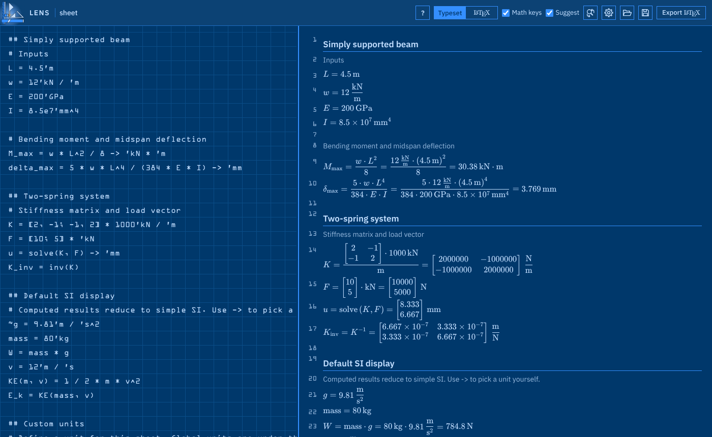

# LENS: Laconic Engineering Notebook System

LENS (package name `laconic`) is a units-aware worksheet built on [Pint](https://pint.readthedocs.io), taking heavy inspiration from the utility of SMath and Mathcad, but aiming to solve my main grievances with both: closed-source designs that avoid integrating with other programs, and poor-quality formatting options. In LENS, you type one expression per line and see typeset results update as you edit, making your back-of-the-napkin calculations into professional documentation in as few keystrokes as possible. You can copy LaTeX snippets or export a whole document.

## Where to start

| I want to... | Read |
|---|---|
| Install LENS or run it from source | [Getting Started](Getting-Started) |
| Learn the language | [Worksheet Syntax](Worksheet-Syntax) |
| Define my own units | [Units](Units) |
| Work with matrices and tables | [Matrices](Matrices) |
| Look up fluid or material data | [Material Properties](Material-Properties) |
| Draw graphs | [Plots](Plots) |
| Solve equations, minimize or maximize | [Solving and Optimizing](Solving-and-Optimizing) |
| Control how results look, export LaTeX | [Output and Export](Output-and-Export) |
| Type faster in the editor | [Editor Shortcuts](Editor-Shortcuts) |
| Change settings or find the settings file | [Settings](Settings) |
| Contribute or understand the code | [Architecture](Architecture) and [Development](Development) |
| See what is not built yet | [Roadmap](Roadmap) |

## Design in three lines

- Worksheets are plain text files (`.lens`), so they diff and merge in git.
- Units are marked with an apostrophe (`'kN`), so a bare name is always a variable.
- One evaluator and one plot spec feed the web page, the LaTeX export and the command line, so all three agree.
